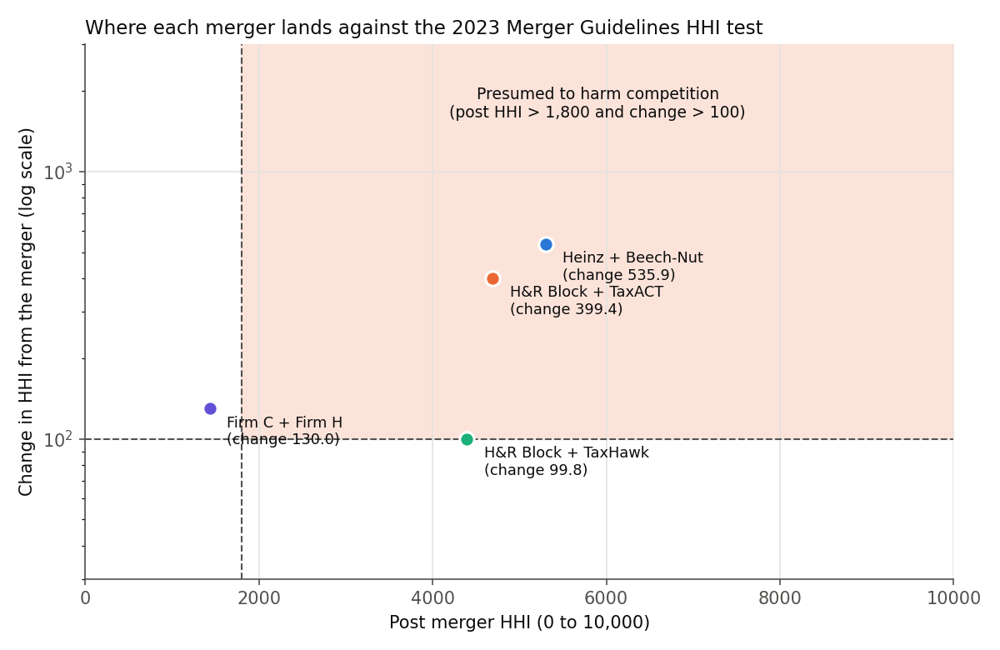
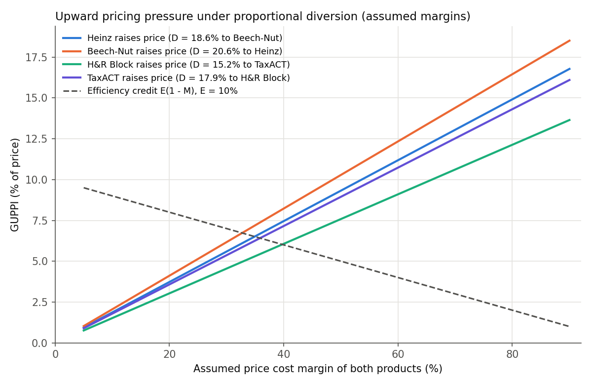

# 01 Merger screen toolkit

The 2023 US Merger Guidelines concentration screen plus a pricing pressure check, tested against two real decisions. Python 3.10+.

## The problem

When competitors announce a deal, antitrust teams at the agencies and consulting firms must decide quickly whether it deserves a deep investigation. This toolkit takes market shares and a list of deals and returns which deals are presumed to harm competition, and why.

## Why it matters

Under Guideline 1 of the 2023 Merger Guidelines (reaffirmed by the FTC in 2025), a merger is presumed to substantially lessen competition if the post merger HHI exceeds 1,800 and the change exceeds 100, or if the merged share exceeds 30 percent and the change exceeds 100. Thresholds are strict, so edge cases matter. Both cases predate 2023; today's thresholds are applied to their printed shares.

## Data

Real shares printed in two court opinions plus a court's teaching example. Nothing is simulated.

| Market | Shares (%) | Source |
|---|---|---|
| US jarred baby food | Gerber 65.0, Heinz 17.4, Beech-Nut 15.4 | Heinz, 246 F.3d at 711 |
| US do-it-yourself tax software, 2010 | Intuit 62.2, H&R Block 15.6, TaxACT 12.8, TaxHawk 3.2, TaxSlayer 2.7 | H&R Block, slip opinion p. 5 |
| Ten firm teaching example | 20, 17, 13, 12, 10, 10, 8, 5, 3, 2 | Heinz, 246 F.3d at 716 n.9 |

`data/mergers.csv` lists two actual deals, one labeled hypothetical and one worked example. `data/court_reported.csv` holds each court's HHI figures for checking. Unnamed fringe share gets lower and upper HHI bounds; flags use the lower bound (`presumed_at_upper_bound` shows the other extreme). Margins are not public, so pricing pressure results are illustrative.

## Method in plain words

1. **Concentration.** The HHI sums squared shares (monopoly = 10,000). Merging shares a and b adds exactly 2ab.
2. **Presumption.** Flag if (post HHI > 1,800 and change > 100) or (combined share > 30 and change > 100).
3. **Pricing pressure.** The diversion ratio is the fraction of one party's lost customers who switch to the other; after the merger those sales stay in house, so raising price pays more. Absent survey data, diversion follows shares.

The math (shares s in points, D12 diversion ratio from product 1 to 2, margin M = (P minus C) / P, cost saving E = 10 percent). GUPPI is the gross upward pricing pressure index; UPP is net upward pricing pressure:

- D12 = s_2 / (100 minus s_1), assuming all lost sales stay in the market
- GUPPI_1 = D12 x M_2 x P_2 / P_1
- Net UPP per dollar = GUPPI_1 minus E (1 minus M_1) (Farrell and Shapiro's test, divided by P_1)
- With equal margins and prices, net UPP is zero at the break even margin M* = E / (D12 + E)

## How to run

```bash
cd projects/01-merger-screen
python -m venv .venv
source .venv/bin/activate
pip install -r requirements.txt
python run.py
pytest
```

Your own data: `python run.py --shares my_shares.csv --mergers my_deals.csv --out my_output`. Default outputs go to `output/` and `report/summary.md` (one page for a manager).

## Results

| Merger | Type | Combined share (%) | Pre HHI | Change in HHI | Post HHI | HHI test | 30% share test | Presumed harmful |
|---|---|---:|---:|---:|---:|:-:|:-:|:-:|
| Heinz + Beech-Nut | actual | 32.8 | 4,765 | 535.9 | 5,301 | Yes | Yes | Yes |
| H&R Block + TaxACT | actual | 28.4 | 4,294 | 399.4 | 4,693 | Yes | No | Yes |
| H&R Block + TaxHawk | hypothetical | 18.8 | 4,294 | 99.8 | 4,393 | No | No | No |
| Firm C + Firm H | worked example | 18.0 | 1,304 | 130.0 | 1,434 | No | No | No |

**Check against the courts.** H&R Block: court 4,291, about 400, 4,691 and 28.4 percent; toolkit 4,294, 399, 4,693 and 28.4 (rounding). Heinz: court 4,775 and 510; printed shares give 4,765 and 536 (2 x 17.4 x 15.4), so the court used unprinted data; both are five times the threshold. The footnote example matches exactly.



**Edge case.** H&R Block buying TaxHawk would add 99.84 points on the printed shares in a market above 4,000, so the screen would not flag it. With one decimal rounding the true change could be 98.0 to 101.7, so the answer turns on rounding.



**Pricing pressure (assumed margins).** Share based diversion runs from 15.2 percent (H&R Block to TaxACT) to 20.6 percent (Beech-Nut to Heinz). At a 50 percent margin GUPPIs are 7.6 to 10.3 percent of price; net UPP turns positive above margins of 33 to 40 percent. The H&R Block court rejected simulated diversion estimates of 1.6 and 32.4 percent for this pair (slip opinion pages 45 to 46).

## What I would do next

- Logit merger simulation for predicted price changes.
- Measured diversion from surveys or win/loss data.

## Sources

1. DOJ and FTC, *Merger Guidelines* (2023), Sections 2.1 and 4.2.B. https://www.justice.gov/d9/2023-12/2023%20Merger%20Guidelines.pdf
2. FTC press release (Feb. 18, 2025). https://www.ftc.gov/news-events/news/press-releases/2025/02/ftc-chairman-andrew-n-ferguson-announces-ftc-dojs-joint-2023-merger-guidelines-are-effect
3. *FTC v. H.J. Heinz Co.*, 246 F.3d 708 (D.C. Cir. 2001). https://www.ftc.gov/sites/default/files/documents/cases/2001/04/010427heinz-milnot-appellatecourtppinion.pdf
4. *United States v. H&R Block, Inc.*, 833 F. Supp. 2d 36 (D.D.C. 2011). https://law.justia.com/cases/federal/district-courts/district-of-columbia/dcdce/1:2011cv00948/148296/108/
5. Farrell and Shapiro (2010), *B.E. Journal of Theoretical Economics* 10(1). Working paper: https://eml.berkeley.edu/~farrell/ftp/Unilateral73.pdf
