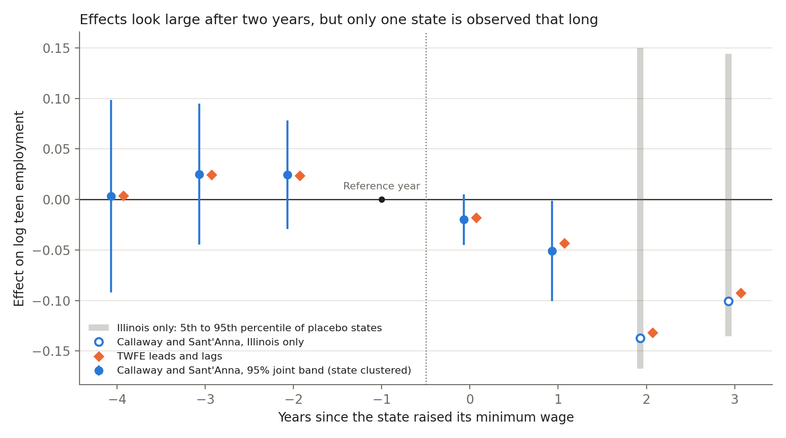
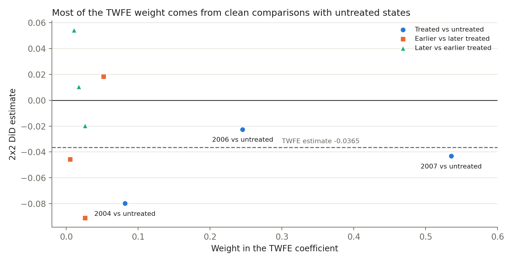

# 03 Staggered difference in differences

**Result:** on real minimum wage data, the usual regression lands close to a modern estimator (a 3 to 4 percent teen employment decline, borderline significant), but the large long run effect rests on one state.

## The problem

Between 2004 and 2007, some US states raised their minimum wage and others did not. What happened to teen employment? The standard tool, a two way fixed effects (TWFE) regression, also uses already treated states as controls, which can bias it when effects change over time.

## Why it matters

In a simulated stress test with growing effects, TWFE reports 0.049 when the truth is 0.186. Analysts must know whether that happens in their data.

## Data

`data/mpdta.csv` is the real sample shipped with the `did` R package: log teen employment in 500 counties across 29 states, 2003 to 2007, measured in the first quarter, ahead of the July 2007 federal increase. Cohorts: 20 counties first treated in 2004 (all Illinois), 40 in 2006, 131 in 2007, 309 never treated. The authors call this subset illustrative. `data/math_reform.csv` only tests the decomposition. `python get_data.py` rebuilds both.

## Method in plain words

1. **TWFE baseline.** One post treatment coefficient.
2. **Goodman-Bacon decomposition.** Split it into every two group, two period comparison.
3. **Group time effects.** For each cohort and year, compare the change since the pre treatment year with the same change in never treated counties, then aggregate.
4. **Inference.** States set the policy, so errors are clustered by state. That fails when one state stands alone, so I also use placebo states and shuffle cohorts across states.

The math (C comparison group, n_g cohort size):

- TWFE: y_it = a_i + l_t + b D_it + e_it, where b = sum of s_kl b_kl over pairs and the weights s_kl sum to 1
- ATT(g,t) = E[y_t minus y_(g-1) | G = g] minus E[y_t minus y_(g-1) | C]
- Overall = sum over g of (n_g / sum of n) x mean over t >= g of ATT(g,t)
- Variances use unit influence functions
- Placebo p = (1 + states at least as extreme) / (1 + placebos)

## How to run

```bash
cd projects/03-staggered-did
python -m venv .venv
source .venv/bin/activate
pip install -r requirements.txt
python run.py
pytest
```

Runs in under a minute. Outputs go to `output/`; `report/summary.md` is for managers.

## Results

| Estimator | Estimate | County SE | State SE |
|---|---:|---:|---:|
| TWFE, single post dummy | -0.0365 | 0.0133 | 0.0227 |
| CS overall, cohort weighted (preferred) | -0.0310 | 0.0124 | 0.0121 |
| CS simple, all treated cells | -0.0400 | 0.0120 | 0.0154 |
| CS event study average | -0.0772 | 0.0200 | 0.0150 |
| CS event study average, same cohorts at years 0 and 1 | -0.0288 | 0.0137 | 0.0167 |
| CS overall, not yet treated as controls | -0.0305 | 0.0126 | 0.0119 |
| CS overall, adjusting for log population | -0.0329 | 0.0119 | 0.0129 |
| CS overall, without Illinois | -0.0253 | 0.0134 | 0.0121 |
| Same weights, all pre years as base | -0.0426 | n/a | n/a |

Log points: -0.031 is roughly -3.1 percent. CS is Callaway and Sant'Anna.





- **TWFE holds up here.** Only 5.4 percent of its weight uses already treated controls; 86 percent is against untreated states.
- **The base year matters.** Averaging from all pre years gives -0.043, not -0.031, because the 2007 cohort fell 0.031 the year before treatment. The chart shows this dip as positive points before year -1.
- **Significance is borderline.** Shuffling cohorts across states gives p = 0.05 for the preferred estimate (0.015 on its t statistic), so its clustered interval of -0.055 to -0.007 is likely too tight. Dropping any one treated state keeps it between -0.037 and -0.025. TWFE has t = 1.6.
- **The big number is one state.** The event study average of -0.077 becomes -0.029 with the same cohorts in years 0 and 1. Years 2 and 3 are Illinois alone, so clustering cannot measure their noise.
- **Illinois alone proves little.** Five of 16 never treated states show an average gap as large, p = 0.35 (minimum possible 0.06). Illinois raised its wage twice, mixing timing and dose.
- **Pre trends.** The joint test does not reject (p = 0.17 county, 0.28 state), but power is limited.
- **Simulated check, not real data** (independent units, 3,000 draws of 500, simple ATT). Stress test, 90 percent treated over 10 years: truth 0.186, CS 0.186, TWFE 0.049. Shaped like this sample: truth 0.077, CS 0.078, TWFE 0.060. CS intervals cover 93.8 percent, under 95. Few cluster inference is not tested.

**Checks.** Tests reproduce published `did` output (including pre test p = 0.16812) and `bacondecomp` weights. `python cross_check.py` matches moderndid 0.4.1 and pyfixest 0.60.0 within 1e-7.

## What I would do next

Run the full 2,284 county sample, add pre trend sensitivity bounds and a wild cluster bootstrap, and scale effects by wage increase size.

## Sources

1. Callaway and Sant'Anna (2021), Journal of Econometrics 225(2), 200-230. [doi](https://doi.org/10.1016/j.jeconom.2020.12.001), [working paper with sample details](https://arxiv.org/abs/1803.09015v2).
2. Goodman-Bacon (2021), Journal of Econometrics 225(2), 254-277. [RePEc](https://econpapers.repec.org/RePEc:eee:econom:v:225:y:2021:i:2:p:254-277).
3. Conley and Taber (2011), Review of Economics and Statistics 93(1), 113-125. [RePEc](https://econpapers.repec.org/RePEc:tpr:restat:v:93:y:2011:i:1:p:113-125).
4. [`did` package](https://github.com/bcallaway11/did) and [vignette](https://cran.r-project.org/web/packages/did/vignettes/did-basics.html): data and published output.
5. [`bacondecomp` package](https://github.com/evanjflack/bacondecomp): data and published decomposition.
