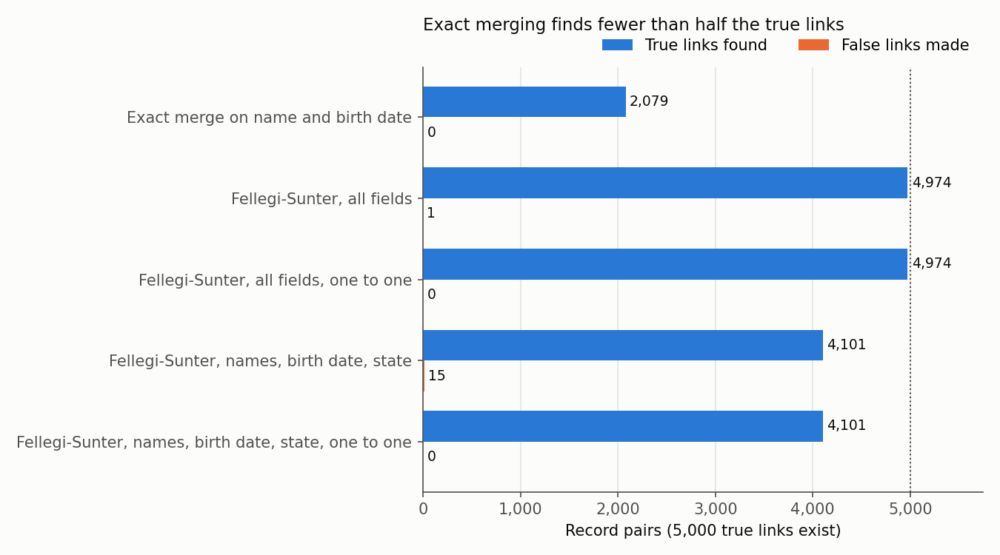
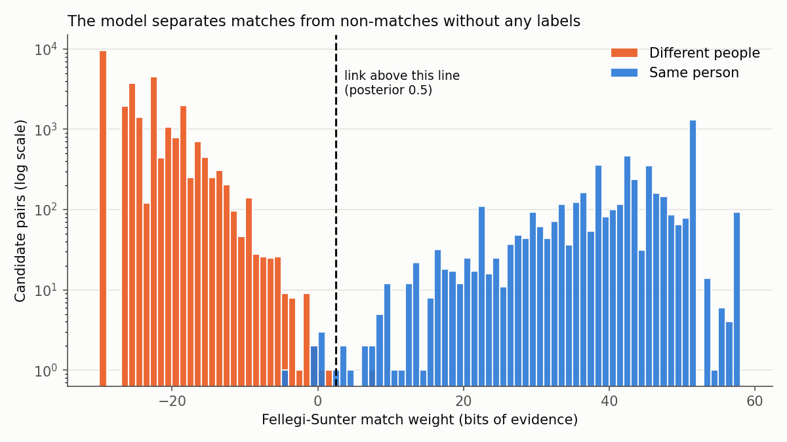

# Probabilistic record linkage without a shared ID

Blocking, Jaro-Winkler similarity and a Fellegi-Sunter model fitted by EM, scored against known true pairs.

## The problem

A researcher merging a survey with administrative records, or a consultant joining a client list to a vendor file, often lacks a shared ID, and fields contain typos. The decision: which pairs are the same person? False links contaminate downstream regressions; missed links shrink and select the sample. This project scores every candidate pair, predicts its own precision without labels, and checks it against the truth.

## Why it matters

Much applied economics rests on linked records. An exact merge on name and birth date silently drops every record with a typo; here it finds only 42% of true links.

## Data

FEBRL 4, the standard linkage benchmark (Christen 2008), as shipped in the `recordlinkage` package (BSD 3 clause). File A has 5,000 records; file B has one corrupted duplicate of each. **Every record is synthetic, made by the FEBRL generator; none is a real person.** Record ids reveal true pairs, used only for evaluation; the synthetic ID number column is dropped. `python get_data.py` rebuilds `data/` from pinned upstream files and checks hashes.

## Method in plain words

1. **Blocking.** Of 25 million pairs, keep those sharing postcode, Soundex surname plus birth year, Soundex given name plus birth year, birth date, or both Soundex names. Several keys survive a typo in one.
2. **Comparison.** Grade each field as agree, partial, disagree or missing. Names and addresses use Jaro-Winkler similarity (agree at 0.94, partial at 0.88); postcodes allow one wrong digit; birth dates allow one of year, month or day to differ.
3. **Scoring without labels.** Each pair is a match or not, with fields independent within each group. EM estimates each grade's frequency among matches (m) and non-matches (u), and each pair's match probability.
4. **Decision.** Link pairs with probability at least 0.5; optionally keep at most one link per record, strongest first.

With comparison vector γ, match share λ among candidate pairs, and fields k,

P(match | γ) = λ ∏ₖ mₖ(γₖ) / [ λ ∏ₖ mₖ(γₖ) + (1 − λ) ∏ₖ uₖ(γₖ) ],

and the match weight is W = Σₖ log₂(mₖ(γₖ)/uₖ(γₖ)). Missing fields drop out (Enamorado, Fifield and Imai 2019). Posterior 0.5 means W above log₂((1 − λ)/λ) = 2.51 bits.

## How to run

From the repository root (Python 3.13):

```bash
cd projects/05-record-linkage
python -m venv .venv
source .venv/bin/activate
pip install -r requirements.txt
python run.py
pytest
```

Tests include known answers (published Jaro-Winkler values, Soundex codes, hand computed posteriors) and EM recovery of simulated m and u.

## Results

Blocking keeps 33,263 pairs (0.13% of all pairs) and 4,981 of 5,000 true pairs. Without labels, EM estimates 4,977 matches among candidates; the truth is 4,981.

| Method | Links | True found | False | Missed | Precision | Recall |
|---|---|---|---|---|---|---|
| Exact merge on name and birth date | 2,079 | 2,079 | 0 | 2,921 | 1.0000 | 0.4158 |
| Fellegi-Sunter, all fields | 4,975 | 4,974 | 1 | 26 | 0.9998 | 0.9948 |
| Fellegi-Sunter, all fields, one to one | 4,974 | 4,974 | 0 | 26 | 1.0000 | 0.9948 |
| Fellegi-Sunter, names, birth date, state | 4,116 | 4,101 | 15 | 899 | 0.9964 | 0.8202 |
| Same, one to one | 4,101 | 4,101 | 0 | 899 | 1.0000 | 0.8202 |





* **With all fields the model knows its precision:** predicted precision (mean accepted posterior) 0.9997, actual 0.9998.
* **Without addresses its self check fails:** blocking without postcode (8,725 pairs) and scoring names, birth date and state, it predicts precision 0.9329; actual is 0.9964. Audit a sample anyway.
* **One to one assignment removes every false link here,** since each shared a record with a true link scored at least as high.
* **Blocking distorts u:** postcode agreement carries about zero weight (−0.03 bits) since blocking made most candidates agree on it.
* 21 pairs sit between posterior 0.05 and 0.95, 9 of them true: the clerical review queue.

**Caveats.** FEBRL 4 is cleaner than real data, so these numbers are likely optimistic. I added the fifth blocking key after seeing which true pairs the others missed; on new data, choose keys from a hand reviewed sample.

## What I would do next

* Catch swapped given name and surname.
* Weight rare surnames more (frequency based m and u).
* Carry posteriors into the downstream regression instead of a hard cut.
* Test on messier data and firm names.

## Sources

1. Fellegi, I. P., and A. B. Sunter (1969). "A Theory for Record Linkage." *JASA* 64(328): 1183 to 1210.
2. Jaro, M. A. (1989). "Advances in Record-Linkage Methodology as Applied to Matching the 1985 Census of Tampa, Florida." *JASA* 84(406): 414 to 420.
3. Winkler, W. E. (1990). "String Comparator Metrics and Enhanced Decision Rules in the Fellegi-Sunter Model of Record Linkage." *Proceedings of the Section on Survey Research Methods*, ASA: 354 to 359.
4. Enamorado, T., B. Fifield, and K. Imai (2019). "Using a Probabilistic Model to Assist Merging of Large-Scale Administrative Records." *American Political Science Review* 113(2): 353 to 371.
5. Christen, P. (2012). *Data Matching.* Springer.

Data: Christen, P. (2008). "Febrl: A Freely Available Record Linkage System with a Graphical User Interface." HDKM 2008. Files from `recordlinkage` 0.16 (github.com/J535D165/recordlinkage).
