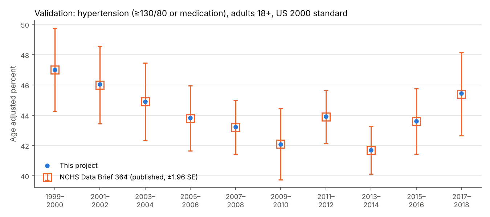
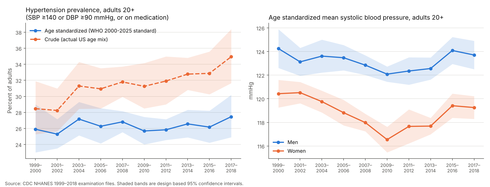

# 06 · Age standardized blood pressure and hypertension in US adults, NHANES 1999 to 2018

## The problem

A ministry of health or a burden of disease team needs one comparable yearly number for how common high blood pressure is. Crude prevalence mixes risk at each age with how old the population is. This project builds design based estimates of mean systolic blood pressure (SBP) and hypertension prevalence from ten cycles of US examination microdata, age standardized to the WHO World Standard Population, with 95% confidence intervals. It first reproduces 30 published NCHS estimates.

## Why it matters

High SBP is a leading risk factor, and exposure estimates like these feed attributable burden calculations. Crude hypertension rose 6.5 points since 1999, yet the age standardized rate shows no detectable change: ageing drives most of the increase, so service needs grow even if age specific risk does not.

## Data

* CDC NHANES public files `DEMO`, `BPX` (exam blood pressure) and `BPQ` (medication), cycles 1999-2000 to 2017-2018, from `https://wwwn.cdc.gov/Nchs/Data/Nhanes/Public/{year}/DataFiles/`, accessed 2026-11-07.
* `data/nhanes_bp_extract.csv.gz` (1 MB, 56,367 examined adults, public variables), rebuilt by `python get_data.py`.
* `data/benchmarks/nchs_db364_figure4.csv`, the published validation table.

Later files (2017 to March 2020, 2021 to 2023) use an oscillometric device (`BPXO`), so they are not spliced onto this series.

## Method in plain words

1. **Measure.** SBP and diastolic pressure (DBP) are the average of up to three readings; a diastolic 0 is ignored unless all are 0. Pregnant women are excluded.
2. **Classify.** Hypertension is SBP ≥140 or DBP ≥90 mmHg or taking prescribed medication (the WHO and NCD-RisC definition). The 2017 ACC/AHA 130/80 cut points are also reported.
3. **Weight.** Examination weights (`WTMEC2YR`) make the sample represent the population.
4. **Standardize.** Estimate the weighted mean in each age group (20-29 to 80+; NHANES top codes age at 85 before 2007 and at 80 after), then average the group means with fixed WHO standard weights, so ageing cannot move the result.
5. **Uncertainty.** Taylor linearization over the sampled clusters (PSUs) within strata, with t intervals on PSUs minus strata degrees of freedom; proportions use a logit interval.

For age group $g$ with standard weight $s_g$, $\hat R_g = \sum_i w_i y_i 1_{ig} / \sum_i w_i 1_{ig}$ and $\hat\theta = \sum_g s_g \hat R_g$. With linearized values $z_i = \sum_g s_g 1_{ig} w_i (y_i - \hat R_g)/\hat N_g$,

$$\hat V(\hat\theta) = \sum_h \frac{n_h}{n_h - 1} \sum_j (z_{hj} - \bar z_h)^2,$$

where $z_{hj}$ is the PSU total. People outside the analysis domain keep $z_i = 0$ but their PSU stays in the design. Changes between cycles add the two independent variances.

## How to run

```bash
cd projects/06-health-nhanes-blood-pressure
python3 -m venv .venv && source .venv/bin/activate   # Python 3.11+ (tested on 3.13)
pip install -r requirements.txt
python run.py                      # rewrites output/: every table, chart and number below
pytest                             # 18 tests, including the NCHS reproduction
python get_data.py                 # optional: rebuild the extract from CDC
Rscript validation/crosscheck.R    # optional: independent check with R survey 4.2.1
```

## Results

**Validation.** With the NCHS definition (≥130/80 or medication, adults 18+, US 2000 standard), the pipeline reproduces all 30 age adjusted estimates in NCHS Data Brief 364 (ten cycles; total, men, women) within 0.07 points, matches their standard errors, and recovers the 2017-2018 sample size of 5,199 exactly. `validation/crosscheck.R` re-estimates the 60 crude and WHO standardized values for all adults (10 cycles, 3 indicators) from the same extract with R `survey::svystandardize`; they agree within 0.0001.



**Adults 20+, WHO standard, 95% confidence intervals** (all cycles and sexes in `output/`):

| Indicator | 1999-2000 crude | 1999-2000 age std. | 2017-2018 crude | 2017-2018 age std. |
|---|---|---|---|---|
| Hypertension ≥140/90 or meds (%) | 28.5 (25.3 to 31.9) | 25.9 (23.0 to 29.0) | 34.9 (31.6 to 38.4) | 27.5 (24.9 to 30.2) |
| Hypertension ≥130/80 or meds (%) | 47.2 (44.0 to 50.3) | 44.6 (41.4 to 47.7) | 49.7 (46.9 to 52.5) | 43.0 (40.0 to 46.1) |
| Mean SBP, men (mmHg) | 124.6 (122.9 to 126.2) | 124.3 (122.6 to 125.9) | 125.0 (123.9 to 126.1) | 123.7 (122.5 to 124.9) |
| Mean SBP, women (mmHg) | 122.7 (120.9 to 124.5) | 120.4 (119.3 to 121.6) | 123.0 (121.6 to 124.3) | 119.3 (118.3 to 120.2) |

* Crude hypertension (≥140/90 or meds) rose 6.5 points (95% CI 1.7 to 11.2); the age standardized rate changed 1.6 points (−2.4 to 5.6), not distinguishable from zero.
* Age standardized mean SBP changed −0.9 mmHg (−2.5 to 0.7).
* Swapping the WHO standard for the US 2000 standard gives the same change, 1.6 points (−2.5 to 5.7).
* Plausibility: SBP rises with age (2017-2018: 118 to 139 mmHg in men, 110 to 147 in women); `run.py` stops if range and age pattern checks fail.



## Limitations

* A single visit overstates hypertension relative to repeat visit diagnosis.
* Standardized values compare only with series on the same standard.
* Medication status is self reported.
* Two year cycles carry intervals of about ±3 points.

## What I would do next

* Bridge auscultatory and oscillometric readings using the 2017-2018 participants measured both ways (`BPXO_J`), then extend to 2023.
* Use these SBP distributions in a population attributable fraction for ischemic heart disease.

## Sources

1. Ahmad OB, Boschi-Pinto C, Lopez AD, Murray CJL, Lozano R, Inoue M. *Age standardization of rates: a new WHO standard.* GPE Discussion Paper 31, WHO, 2001. [PDF](https://cdn.who.int/media/docs/default-source/gho-documents/global-health-estimates/gpe_discussion_paper_series_paper31_2001_age_standardization_rates.pdf)
2. Klein RJ, Schoenborn CA. *Age adjustment using the 2000 projected U.S. population.* Healthy People 2010 Statistical Notes 20, 2001. [PDF](https://www.cdc.gov/nchs/data/statnt/statnt20.pdf)
3. Ostchega Y, Fryar CD, Nwankwo T, Nguyen DT. *Hypertension prevalence among adults aged 18 and over: United States, 2017–2018.* NCHS Data Brief 364, 2020. [Tables](https://www.cdc.gov/nchs/data/databriefs/db364-tables-508.pdf)
4. NCHS. *NHANES tutorials: variance estimation.* [Web](https://wwwn.cdc.gov/nchs/nhanes/tutorials/VarianceEstimation.aspx)
5. NCD Risk Factor Collaboration. Worldwide trends in hypertension prevalence and progress in treatment and control from 1990 to 2019. *Lancet* 2021;398:957–980. [doi](https://doi.org/10.1016/S0140-6736(21)01330-1)
6. Lumley T. Analysis of complex survey samples. *J Stat Softw* 2004;9(8). [doi](https://doi.org/10.18637/jss.v009.i08)
