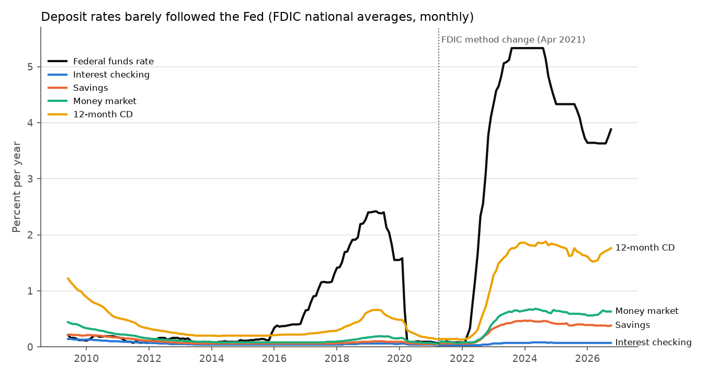
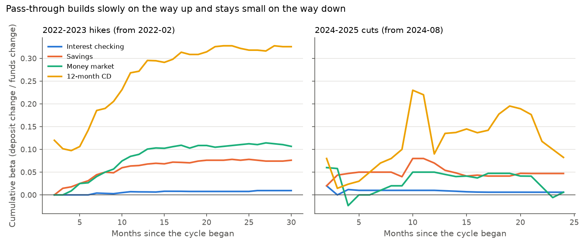

# 07 · Deposit betas: how much of a Fed move reaches depositors

## The problem

When the Fed moves its rate, a bank must forecast how far its deposit rates will follow. That share is the deposit beta. This project measures betas for four US deposit products over four Fed cycles, tests whether rates rise and fall alike, and forecasts 12 month deposit cost under three scenarios.

## Why it matters

A beta off by 0.1 on $10 billion of deposits misprices funding cost by $10 million a year per point the Fed moves. Planning needs betas by product and direction.

## Data

FRED series, downloaded 2026-11-08 to `data/raw/` (84 KB); `get_data.py` refreshes them.

* `FEDFUNDS`: effective federal funds rate, monthly average.
* FDIC national rates for interest checking, savings, money market and 12-month CDs. Through 2021-03 (`ICNRNJ`, `SAVNRNJ`, `MMNRNJ`, `CD12NRNJ`) they are weekly simple averages of posted rates, which I average by month. From 2021-04 (`ICNDR`, `SNDR`, `MMNDR`, `NDR12MCD`) they are deposit weighted averages across insured banks and credit unions (FDIC FIL-24-2021), published to 0.01 points.

The two FDIC methods are never spliced; the monthly change across the break is dropped. The panel has 209 months, 2009-06 to 2026-10.

## Method in plain words

1. **Cycle betas.** Change in the deposit rate divided by change in the funds rate, from the month before the Fed's first move to the last month before it reversed (2019-2020 stops at the 2021 FDIC break). Months on hold are included, so slow catch-up counts; `output/cycle_betas.csv` also gives the beta at the Fed's last move.
2. **Pass-through regression.** Regress each month's deposit rate change on this month's and the previous six months' funds rate changes, with separate coefficients for increases and decreases. Summing the lags gives long run betas up and down, as in Drechsler, Savov and Schnabl (2017). The asymmetry test follows Neumark and Sharpe (1992).
3. **Uncertainty.** Newey and West (1987) standard errors for autocorrelated monthly changes.
4. **Scenarios.** Feed a funds rate path through the lag coefficients from October 2026 rates (recent moves keep passing through) and price an illustrative deposit mix.

$$\Delta d_{p,t} = a_p + \sum_{k=0}^{6} \beta^{+}_{p,k}\,\Delta f^{+}_{t-k} + \sum_{k=0}^{6} \beta^{-}_{p,k}\,\Delta f^{-}_{t-k} + \varepsilon_{p,t}$$

with $\Delta f^{+} = \max(\Delta f, 0)$ and $\Delta f^{-} = \min(\Delta f, 0)$. Long run betas are $B^{\pm}_p = \sum_k \beta^{\pm}_{p,k}$; the asymmetry test is a Wald test of $B^{+}_p = B^{-}_p$. The main sample is the consistent 2021 method series (66 months); the pooled 2009 to 2026 sample is a robustness check.

## How to run

```bash
cd projects/07-deposit-betas
python3 -m venv .venv && source .venv/bin/activate   # Python 3.11+ (tested on 3.13)
pip install -r requirements.txt
python run.py      # rewrites output/: every table, chart and number below
pytest             # 18 tests: hand calculations, exact recovery, statsmodels cross-check
python get_data.py # optional: download the latest FRED vintage
```

`run.py` stops if any sanity check fails.

## Results

**Deposit betas** (cycle betas; regression on 2021-05 to 2026-10, six lags, HAC standard errors):

| Product | 2015-2018 hikes | 2019-2020 cuts | 2022-2023 hikes | 2024-2025 cuts | Regression up beta (SE) | Regression down beta (SE) |
|---|---|---|---|---|---|---|
| Interest checking | 0.009 | 0.012 | 0.010 | 0.006 | 0.008 (0.002) | 0.011 (0.008) |
| Savings | 0.017 | 0.025 | 0.076 | 0.047 | 0.079 (0.005) | 0.050 (0.022) |
| Money market | 0.045 | 0.052 | 0.107 | 0.006 | 0.121 (0.014) | 0.010 (0.050) |
| 12-month CD | 0.174 | 0.196 | 0.326 | 0.082 | 0.298 (0.031) | 0.242 (0.132) |



* **National average betas are low.** In 2022 to 2023 the funds rate rose 5.25 points; the average 12-month CD rate rose 1.71 (beta 0.33) and savings 0.40 (beta 0.08).
* **Betas were higher in 2022 than in 2015.** CDs went from 0.17 to 0.33 and savings from 0.017 to 0.076. Part of this gap may come from the FDIC's switch to deposit weighting between the two cycles.
* **Up beats down, but weakly in the main sample.** Up betas exceed down betas for savings, money market and CDs (Wald p 0.24, 0.06, 0.70, t with 51 df). The pooled sample gives p < 0.001 for all three, but includes 2020, when near zero deposit rates could not fall, so it is an upper bound.
* **The 2024-2025 cut betas depend on the end month.** Measured at the last cut (2026-01), money market is 0.047 (not 0.006) and CDs 0.14 (not 0.082), because those rates rose during the 2026 hold.
* **The two methods agree.** Regression up betas are within 0.03 of the 2022 cycle betas and move at most 0.02 with three or nine lags (`output/pass_through_all.csv`).



**Scenario per $1 billion of interest bearing deposits** (assumed mix: 30% checking, 25% savings, 25% money market, 20% CDs). Annual interest cost is $6.26 million at October 2026 rates. After 12 months it is $6.51 million if the Fed holds (the September 2026 hike is still passing through), $5.93 million after four quarter point cuts and $7.07 million after two quarter point hikes.

**Limits.** National averages of posted rates are weighted toward the largest banks and are not interest expense; a bank that competes on rate can differ a lot. Checking rates move in 0.01 steps, so that regression mostly fits rounding.

## What I would do next

* Bank level betas from Call Report interest expense with bank fixed effects, as in Drechsler, Savov and Schnabl (2017).
* An error correction model so deposit rates return to a long run spread.
* Carry parameter uncertainty into scenario costs.

## Sources

* Drechsler, I., Savov, A. and Schnabl, P. (2017). "The Deposits Channel of Monetary Policy." *Quarterly Journal of Economics* 132(4): 1819 to 1876.
* Neumark, D. and Sharpe, S. A. (1992). "Market Structure and the Nature of Price Rigidity: Evidence from the Market for Consumer Deposits." *Quarterly Journal of Economics* 107(2): 657 to 680.
* Newey, W. K. and West, K. D. (1987). "A Simple, Positive Semi-Definite, Heteroskedasticity and Autocorrelation Consistent Covariance Matrix." *Econometrica* 55(3): 703 to 708. Bandwidth: Newey and West (1994), *Review of Economic Studies* 61(4): 631 to 653.
* FDIC (2021). FIL-24-2021, "Updated Webpage For Revised Interest Rate Restrictions Applicable to Less Than Well Capitalized Institutions." https://www.fdic.gov/news/financial-institution-letters/2021/fil21024.html
* Federal Reserve Bank of St. Louis, FRED. https://fred.stlouisfed.org
