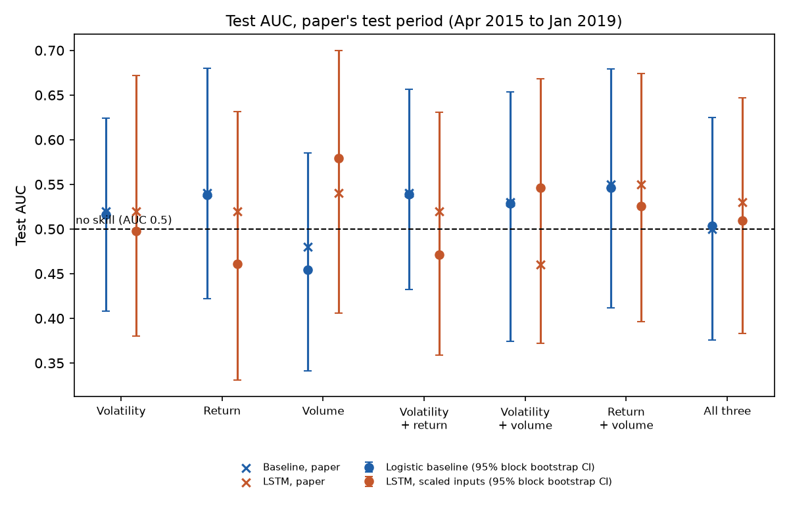
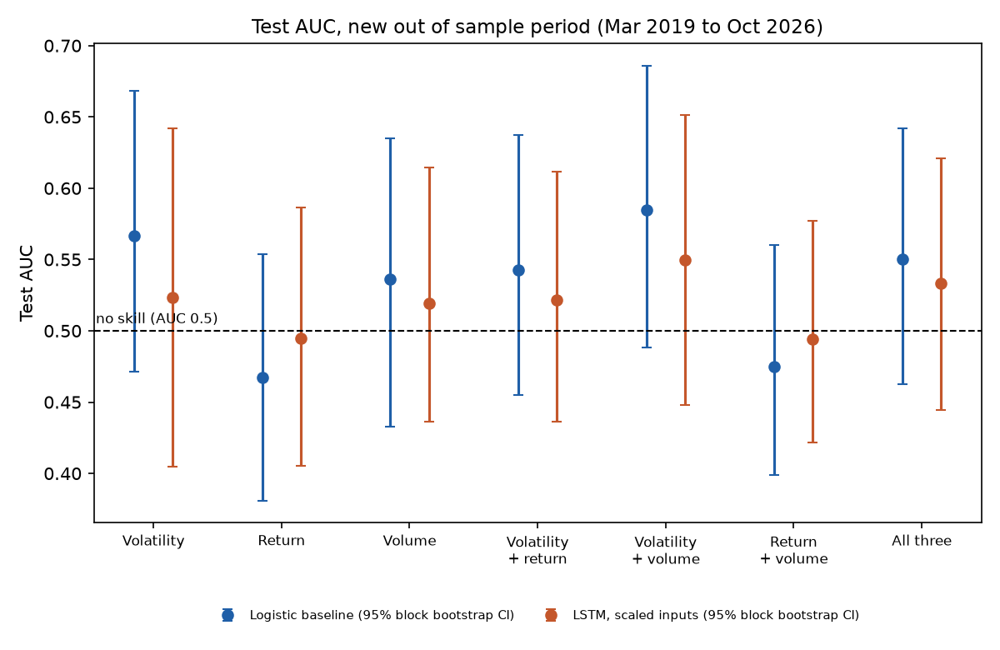

# 08. Replicating "Predicting stock prices with LSTM networks" (Stanford CS230, 2019)

## The paper

Duemig, D. (2019). *Predicting stock prices with LSTM networks.* Stanford CS230 (Deep Learning) course project report, Winter 2019. Listed on the [CS230 past projects page](https://github.com/cs230-stanford/website-2019-fall/blob/master/past-projects.md); report hosted at [cs230.stanford.edu](https://cs230.stanford.edu/projects_winter_2019/reports/15624789.pdf); author's code at [github.com/duemig](https://github.com/duemig/Stanford-Project-Predicting-stock-prices-using-a-LSTM-Network).

**Status: student course report, not peer reviewed.** How the paper was authenticated is in [output/authentication.md](output/authentication.md).

## The question

Can past returns, volatility and trading volume predict whether the S&P 500 will be up over the next 21 trading days (about a month)? The paper trained a stateful LSTM and a regularized logistic regression on each of 7 feature combinations and reported test accuracies of 60% to 66%. We ask two things: does the result reproduce, and is it skill or something else?

## Data

Daily S&P 500 index (^GSPC) close and volume from the Yahoo Finance chart endpoint, the same source the notebook used, downloaded 8 Nov 2026 by `get_data.py`. The original download tool returned 31 Dec 1979 to 27 Feb 2019 (9,875 rows), one trading day earlier at both ends than the dates the notebook asked for; only this window reproduces the notebook's printed feature table (31 Jul 1981 to 28 Jan 2019). The extension adds 1 Mar 2019 to 6 Nov 2026.

## Method

**Features (23 windows each, from 1 to 80 weeks):** cumulative log return, realized volatility (scaled by the square root of the window), and average volume. **Label:** 1 if the next 21 trading days' log return is positive. **Split:** the last 10% of days (946, Apr 2015 to Jan 2019) is the test set. **Models:** logistic regression trained by stochastic gradient descent with an elastic net penalty grid, and a one layer stateful LSTM (batch size 1, one epoch, Keras 2 hard sigmoid gates), both exactly as configured in the notebook.

**Stress tests added here:**
1. **Always up benchmark.** Accuracy is compared with predicting "up" every day.
2. **AUC with honest intervals.** 95% moving block bootstrap (63 day blocks, 2,000 draws), because overlapping 21 day labels make daily observations far from independent.
3. **Purged validation.** Training rows whose 21 day label reaches into the validation fold are dropped (Lopez de Prado, 2018, ch. 7).
4. **Scaled LSTM inputs.** The original fed raw volume (in the billions) into the LSTM; we also train with inputs standardized on the training set only.
5. **Seeds.** Every LSTM is trained with 5 seeds (3 in the extension); we report the range and the seed average.
6. **True out of sample.** Every specification is frozen, retrained on all 1981 to 2019 data, and tested on Mar 2019 to Oct 2026, which shares no returns with training.

## How to run

```bash
python -m venv .venv && source .venv/bin/activate
pip install -r requirements.txt
python get_data.py      # optional: re-download the data (a copy is in data/raw)
python run.py           # about 5 minutes: refits baselines, reads LSTM outputs, writes output/
pytest                  # 24 tests
python lstm_runs.py     # optional: retrain every LSTM from scratch (about 1.5 hours on a CPU)
```

## Replication results

Full table: [output/table1_replication.md](output/table1_replication.md).

* **Data reproduces exactly:** 9,875 raw rows, 9,454 feature rows, the notebook's printed feature values, and the share of up labels in training (62.435%) and test (64.376%) to every digit.
* **Logistic baselines reproduce Table 1:** validation and test accuracy to the reported digit for models 1, 2 and 5; test accuracy exactly for models 4, 6 and 7 (validation within 0.1 point). Model 3's random search ranks a different candidate first in today's library, but refitting the setting the notebook printed reproduces its test accuracy (63.95%), AUC (0.48) and 6 selected features. Two hidden details made this possible: the date window above, and `int((1 // 0.1) - 1)`, which in floating point gives **8** walk forward folds, not 9.
* **LSTMs land in the paper's range** (test accuracy 59.5% to 66.3% across seeds, paper 63.3% to 66.0%). LSTM results vary with the random seed and with TensorFlow versions, so the exact digits cannot be matched; the seed range is the honest comparison.

## Stress tests



| Finding | Evidence |
| --- | --- |
| Accuracy equals the market's drift | Always up scores 64.4% on the test set; the original LSTMs predict "up" on 84% to 100% of days ([table 2](output/table2_paper_test_period.md)) |
| No model ranks months better than chance | All 7 baselines and all 7 LSTMs (original and scaled) have a 95% AUC interval that includes 0.5 |
| Original validation is optimistic | Purging overlapping labels lowers validation accuracy for 6 of the 7 baselines, by up to 8.1 points |
| Scaling fixes the saturated LSTM, not the signal | With scaled inputs the LSTMs stop always predicting up, but AUCs stay between 0.46 and 0.58 with intervals spanning 0.5 |

## Out of sample, Mar 2019 to Oct 2026 (1,913 days)



The market rose in 68.0% of these months. No baseline or LSTM beats always up; the best AUC is 0.58 (baseline, volatility plus volume) with a 95% interval of 0.49 to 0.69. Four of the seven scaled LSTMs predict "down" on most days and score 39% to 48% ([table 3](output/table3_out_of_sample_2019_2026.md)). Every interval includes 0.5.

## Limitations

* One asset and one horizon; the conclusion is about this feature set, not about all market prediction.
* The block bootstrap assumes dependence fades within about three months.
* Seven models were compared without a multiple testing correction; with all intervals already spanning 0.5, a correction would only strengthen the conclusion.
* No trading strategy or costs are simulated, because there is no signal to trade.

## What I would do next

Test features with known economic content (valuation ratios, term spread, credit spread) against the same always up and purged benchmarks, and report a deflated Sharpe ratio for any strategy built on them.

## Sources

* Duemig, D. (2019), Stanford CS230 report and code (links above).
* Lopez de Prado, M. (2018). *Advances in Financial Machine Learning*, Wiley, chapter 7 (purged cross validation).
* Kunsch, H. R. (1989). The jackknife and the bootstrap for general stationary observations. *Annals of Statistics* 17(3), 1217 to 1241 (moving block bootstrap).
* Hochreiter, S., and Schmidhuber, J. (1997). Long short-term memory. *Neural Computation* 9(8), 1735 to 1780.
