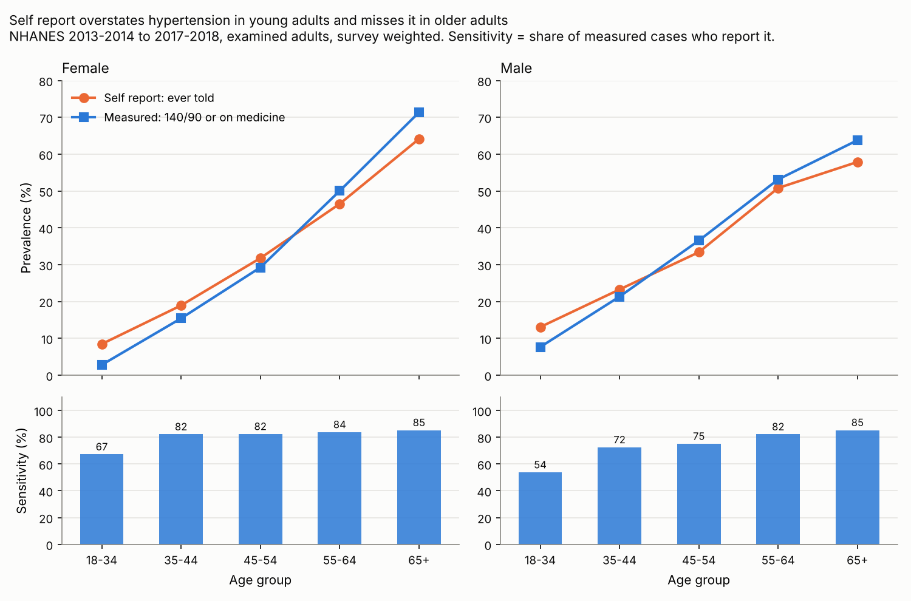
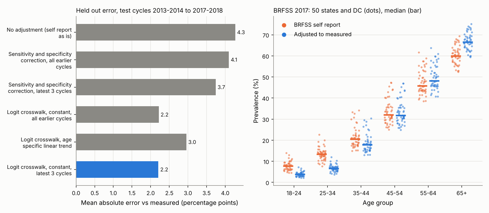

# 09 · Self reported versus measured hypertension: a crosswalk from NHANES applied to BRFSS states

## The problem

Most surveys ask "have you ever been told you have high blood pressure?". Burden of disease teams need measured prevalence (140/90 or higher, or on treatment), so self report must be adjusted before pooling. This project estimates the bias by age and sex from 52,009 NHANES adults who gave both answers, picks the model by out of sample validation, and adjusts every BRFSS state and age group in 2011, 2013, 2015 and 2017 with 1,000 draws.

## Why it matters

Self report errs in both directions. Under age 35 it is 1.7 to 3 times measured prevalence; at 65 and over it misses about one case in ten, net. One correction factor would be wrong at both ends, and unadjusted state figures understate prevalence in the oldest group, the one with the highest cardiovascular risk.

## Data

* CDC NHANES `DEMO`, `BPX` and `BPQ`, cycles 1999-2000 to 2017-2018, `https://wwwn.cdc.gov/Nchs/Data/Nhanes/Public/{year}/DataFiles/`, accessed 2026-11-09: `data/nhanes_htn_extract.csv.gz` (1 MB, 56,367 examined adults).
* CDC BRFSS Prevalence Data, dataset `dttw-5yxu`, `https://data.cdc.gov/resource/dttw-5yxu.json`, topic "High Blood Pressure", age groups, 50 states and DC, odd years 2011 to 2017, accessed 2026-11-09: `data/brfss_hbp_age_2011_2017.csv` (1,224 rows, 27 suppressed by CDC).
* `python get_data.py` rebuilds both from the official sources.

## Method in plain words

1. **Two answers per person.** Self report is `BPQ020` (ever told). Measured is a mean of up to three readings at 140/90 or more, or taking prescribed medicine (NCD-RisC definition). Pregnant women are excluded.
2. **Paired gap.** In each cycle, age group and sex, both prevalences use exam weights, strata and PSUs; *d* is their logit difference, with a standard error that accounts for both answers coming from the same people.
3. **Crosswalk.** A random effects meta-regression of *d* on age by sex cells (the linear case of GBD's MR-BRT crosswalks), with residual heterogeneity τ² by DerSimonian and Laird. Ages 18 to 34 are pooled: women 18 to 24 have a median of 3.5 measured cases per cycle.
4. **Model choice without peeking.** Each cycle from 2005-2006 on is predicted from earlier cycles only. Origins up to 2011-2012 choose among three crosswalk variants; origins 2013-2014 to 2017-2018 only score the choice, against two sensitivity and specificity corrections and no adjustment.
5. **Draws.** Each BRFSS value gets 1,000 draws combining its sampling error, coefficient covariance and τ², using NHANES cycles that started by that year; we report the mean and 2.5th and 97.5th percentiles.

The model is $d_{ct}=x_c'\beta+u_{ct}+e_{ct}$, $u_{ct}\sim N(0,\tau^2)$, $e_{ct}\sim N(0,\hat V_{ct})$, where $\hat V_{ct}$ is the Taylor variance of the person level linearized difference $z_i = w_i[(m_i-\hat p_m)/(\hat p_m\hat q_m)-(s_i-\hat p_s)/(\hat p_s\hat q_s)]/\sum w$. Adjusted prevalence is $\text{expit}(\text{logit}\,p_{\text{self}}+x'\beta)$.

## How to run

```bash
cd projects/09-health-hypertension-crosswalk
python3 -m venv .venv && source .venv/bin/activate   # Python 3.11+ (tested on 3.13)
pip install -r requirements.txt
python run.py                      # about 5 seconds; rewrites output/, stops if a plausibility check fails
pytest                             # 21 tests
python get_data.py                 # optional: rebuild data/ from CDC
Rscript validation/crosscheck.R    # optional: R survey 4.5 and metafor 5.2-1 cross-check
```

## Results

**Known answers.** The meta-regression reproduces the published BCG trials example (log RR −0.7141, τ² 0.3088), the paired standard error matches the closed form delta method, and R `survey` and `metafor` match every estimate within 1e-9.

**Crosswalk**, NHANES 2013-2014 to 2017-2018 (window chosen by validation), τ = 0.07. Negative *d*: self report overstates. All ten cells in `output/crosswalk_age_sex.csv`.

| Age | Sex | Self report % | Measured % | Sensitivity % | d (95% CI) |
|---|---|---|---|---|---|
| 18-34 | Female | 8.4 | 2.8 | 67 | −1.16 (−1.48 to −0.85) |
| 18-34 | Male | 13.1 | 7.6 | 54 | −0.61 (−0.85 to −0.37) |
| 45-54 | Male | 33.4 | 36.5 | 75 | 0.13 (−0.01 to 0.27) |
| 65+ | Female | 64.1 | 71.4 | 85 | 0.33 (0.21 to 0.44) |
| 65+ | Male | 57.9 | 63.8 | 85 | 0.25 (0.13 to 0.38) |



**Validation**, 30 test cells. Mean absolute error: no adjustment 4.3 points; sensitivity and specificity correction 4.1 (3.7 with the latest 3 cycles), because those rates move with prevalence; chosen crosswalk 2.2 (bias −0.4), with 29 of 30 95% intervals covering the held out value. All earlier cycles give the same error but bias +1.4; a linear trend extrapolates badly (3.0). The age only version used for BRFSS: 1.9 points, 13 of 15 covering, so its intervals may be slightly narrow.

**BRFSS 2017, California** (all states and years in `output/brfss_adjusted_state_age.csv`):

| Age | Self report % (95% CI) | Adjusted % (95% UI) |
|---|---|---|
| 18-24 | 6.4 (4.3 to 8.4) | 3.1 (2.0 to 4.5) |
| 35-44 | 17.5 (14.9 to 20.1) | 15.1 (12.2 to 18.4) |
| 65+ | 57.7 (54.6 to 60.8) | 64.6 (60.1 to 68.7) |

In 146 of 299 state by age cells the 2017 UI excludes the self reported value (every state with data at 18-24, 25-34 and 65+). As a check (not a national estimate), the adjusted median state lies within 4.3 points of NHANES measured prevalence at every age (65+: 66.6% versus 68.5%).



## Limitations

* Measured status comes from one visit; medication use is self reported.
* Cells of the same cycle share PSUs, but their sampling covariance is ignored in the meta-regression.
* BRFSS respondents are assumed to report like NHANES respondents of the same age.
* BRFSS age groups lack sex, so states use the age only crosswalk; 18-24 and 25-34 share one coefficient.

## What I would do next

* Bridge to the oscillometric NHANES device to extend past 2018.
* Explain τ² with covariates such as insurance, and test transfer to WHO STEPS surveys.

## Sources

1. GBD 2019 Diseases and Injuries Collaborators. *Lancet* 2020;396:1204–1222 (appendix: MR-BRT crosswalks). [doi](https://doi.org/10.1016/S0140-6736(20)30925-9)
2. Zheng P, et al. Trimmed constrained mixed effects models: formulations and algorithms. [arXiv 1909.10700](https://arxiv.org/abs/1909.10700)
3. DerSimonian R, Laird N. Meta-analysis in clinical trials. *Control Clin Trials* 1986;7:177–188. [doi](https://doi.org/10.1016/0197-2456(86)90046-2)
4. Viechtbauer W. Conducting meta-analyses in R with the metafor package. *J Stat Softw* 2010;36(3). [doi](https://doi.org/10.18637/jss.v036.i03)
5. Rogan WJ, Gladen B. Estimating prevalence from the results of a screening test. *Am J Epidemiol* 1978;107:71–76. [doi](https://doi.org/10.1093/oxfordjournals.aje.a112510)
6. Gonçalves VSS, et al. Accuracy of self-reported hypertension: a systematic review and meta-analysis. *J Hypertens* 2018;36:970–978. [doi](https://doi.org/10.1097/HJH.0000000000001648)
