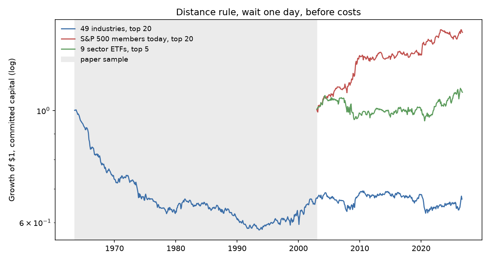
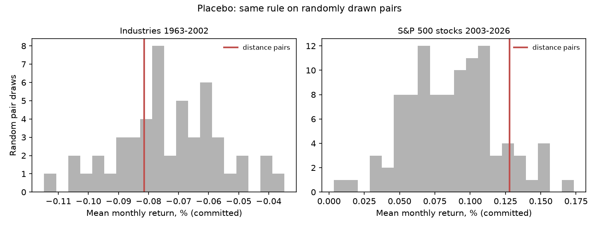

# 10. Pairs trading: replicating Gatev, Goetzmann and Rouwenhorst (2006)

## The paper

Gatev, E., Goetzmann, W. N., and Rouwenhorst, K. G. (2006). Pairs Trading: Performance of a Relative-Value Arbitrage Rule. *Review of Financial Studies* 19(3), 797 to 827. [doi:10.1093/rfs/hhj020](https://doi.org/10.1093/rfs/hhj020). Earlier version: NBER Working Paper 7032 (1999).

**Status: peer reviewed.** Verification evidence is in [output/authentication.md](output/authentication.md).

## The question

The paper pairs each US stock with the stock whose normalized price path is closest over 12 months, then trades the pair over the next 6 months when the prices drift two standard deviations apart. On CRSP stocks, July 1963 to December 2002, the top 20 pairs earn 0.805% a month on committed capital (0.52% if trades wait one day). Does the rule work on public data, survive costs, and persist after 2002?

## Data

* **49 industry portfolios**, daily value weighted returns with dividends, 1961 to Sep 2026 (Kenneth French Data Library, from CRSP; downloaded 9 Nov 2026). Survivorship free.
* **Current S&P 500 members**, daily adjusted closes from the Yahoo chart endpoint, Dec 2001 to 6 Nov 2026, from each stock's first index entry. Point in time membership: the [fja05680/sp500](https://github.com/fja05680/sp500) compilation (commit a2430f2). KVUE and WBD returned no data.
* **Nine Select Sector SPDR ETFs**, Yahoo adjusted closes, Dec 1998 to Nov 2026.
* **Monthly factors** (FF3, momentum, short term reversal), French library.

All raw files are in `data/raw` (4.5 MB); `get_data.py` rebuilds them.

## Method

Faithful to sections 1.3 and 1.4 of the paper:

1. **Formation (12 months).** Normalized price = cumulative total return index. Securities with a missing day are dropped. Each is matched with the partner minimizing the sum of squared deviations (SSD); distinct pairs are ranked by SSD.
2. **Trading (6 months).** Prices are re-normalized to 1. Open when the spread exceeds 2 formation period standard deviations ($1 long the cheap leg, $1 short the dear leg, payoffs reinvested, idle cash earns zero); close when prices cross; force close at the end; a missing return is treated as a delisting.
3. **Portfolios.** A new strategy starts every month, so six overlap; the monthly return is their average. Committed capital divides payoffs by pairs selected; fully invested, by pairs that opened.
4. **Wait one day** executes every open and close one close after the signal.

With 49 industries, "All" is about 38 nearest neighbour pairs and "pairs 101 to 120" has no equivalent.

## How to run

```bash
python -m venv .venv && source .venv/bin/activate
pip install -r requirements.txt
python get_data.py   # optional: re-download (a copy is in data/raw)
python run.py        # about 10 minutes; writes every table, chart and output/headline.json
pytest               # 21 tests, about 5 seconds
```

## Replication results

Paper window, July 1963 to December 2002, 474 months ([table 1](output/table1_replication.md)):

| Top 20, monthly | Paper (CRSP stocks) | Ours (49 industries) |
| --- | --- | --- |
| Fully invested, no wait | 1.44% (t 11.56) | -0.10% |
| Committed, no wait | 0.805% | -0.09% (t -2.47) |
| Committed, wait one day | 0.52% | -0.08% (t -2.33) |
| Round trips per pair | 1.96 | 1.30 |
| Months open per pair | 3.76 | 3.51 |

**The headline does not replicate on public data, and the likely reason is what is traded.** Industry portfolios average away the stock specific noise that reverts, leaving industry momentum (Moskowitz and Grinblatt, 1999); a pairs trade buys the loser and sells the winner, so it is short momentum. The factor regression is consistent with this: on industries, 1963 to 2002, the strategy loads -0.072 on momentum (t -7.6) and +0.072 on short term reversal (t 8.5); the alpha is -0.06% (t -1.6) ([table 3](output/table3_factor_regressions.md)). Distance selection adds nothing on industries: 72% of 50 random pair draws do at least as well.

What does match the paper: where there is no bid ask bounce there is no waiting penalty (waiting moves the industry return by under 0.01 points, against a 0.54 point drop in the paper). A known answer test reproduces the paper's 162 bp implied round trip cost from its rounded figures (unrounded values give about 166 bp).

## Stress tests

Wait one day, committed capital, top 20 (ETFs: top 5); costs per leg per side ([table 2](output/table2_stress_out_of_sample.md)):

| Sample | Mean a month | NW t | 95% bootstrap CI | Break even cost | Net of 5 bp | Net Sharpe |
| --- | --- | --- | --- | --- | --- | --- |
| Industries 1963 to 1988 | -0.149% | -3.47 | -0.237% to -0.061% | n/a (gross < 0) | -0.189% | -0.92 |
| Industries 1989 to 2002 | 0.042% | 0.82 | -0.057% to 0.142% | 4.9 bp | -0.001% | -0.01 |
| Industries 2003 to 2026 | 0.001% | 0.02 | -0.084% to 0.082% | 0.1 bp | -0.040% | -0.20 |
| Sector ETFs 2003 to 2026 | 0.033% | 0.76 | -0.059% to 0.113% | 5.2 bp | 0.002% | 0.01 |
| S&P 500 stocks 2003 to 2026 | 0.128% | 2.95 | 0.045% to 0.219% | 13.3 bp | 0.080% | 0.36 |



Pitfalls checklist:

* **Look ahead.** Pairs and thresholds use formation data only; tests rewrite future returns and check that nothing earlier moves. Fully invested divides by pairs that open later, so it is shown only for comparison.
* **Survivorship.** Industries are survivorship free. The stock sample keeps only today's members (208 of 496 members in Jan 2002, 469 of 503 in May 2025), dropping pairs that blew up, so stock results are **likely biased upward**.
* **Leakage.** No model is fitted and formation and trading windows never overlap, so purging does not apply.
* **Multiple testing.** 24 variants were run on stocks (threshold 1.5 to 3, top 5, top 20 or all, wait or not). The deflated Sharpe ratio of the pre-specified headline (k = 2, wait one day) is 0.92, below 0.95. The best variant (k = 1.5, no wait) scores 0.99, but no wait results include bid ask bounce. Trials correlate 0.67 on average, so 24 overstates the independent tests.
* **Placebo and factors.** On stocks, random pairs under the same rule earn 0.087% a month, two thirds of the distance pairs' 0.128%; distance pairs beat 91 of 100 draws (p = 0.09). After market, size, value, momentum and short term reversal, the stock alpha is 0.145% a month (t 3.38).
* **Costs and capacity.** 5 bp per leg per side suits large caps and ETFs; borrow and impact are not modelled.
* **Uncertainty.** Newey-West errors, 6 lags (as in the paper); stationary bootstrap (6 month blocks, 2,000 draws, fixed seed). The first and last months have fewer than six active strategies (stocks: 278 of 286 months have six).



## Out of sample

All 2003 to 2026 rows follow the paper's sample. Industries and ETFs earn nothing after costs. Stocks earn 0.128% a month before costs, a quarter of the paper's 0.52%, consistent with the decline others report (Zhu, 2024: 0.46% on CRSP, 2003 to 2023). With costs, a likely upward survivorship bias and a deflated Sharpe below 0.95, nothing here supports trading the rule.

## Limitations

* No CRSP, so no Table 1 cell is reproduced from data; the industry test checks the mechanism, not the numbers.
* Stocks are large caps, survivorship biased; the membership file is a community compilation, and a few reused tickers (for example SNDK) can enter before the current company joined the index.
* Stock returns are stored in whole basis points (rounding error under 0.5 bp a day, mean zero).

## Sources

* Gatev, Goetzmann and Rouwenhorst (2006), above.
* Do, B., and Faff, R. (2010). Does Simple Pairs Trading Still Work? *Financial Analysts Journal* 66(4), 83 to 95.
* Zhu, X. (2024). Examining Pairs Trading Profitability. Yale senior essay.
* Moskowitz, T. J., and Grinblatt, M. (1999). Do Industries Explain Momentum? *Journal of Finance* 54(4), 1249 to 1290.
* Bailey, D. H., and Lopez de Prado, M. (2014). The Deflated Sharpe Ratio. *Journal of Portfolio Management* 40(5), 94 to 107.
* Kenneth R. French Data Library; Yahoo Finance; fja05680/sp500.
