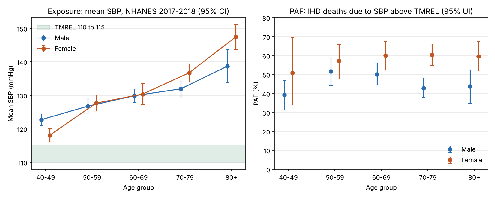
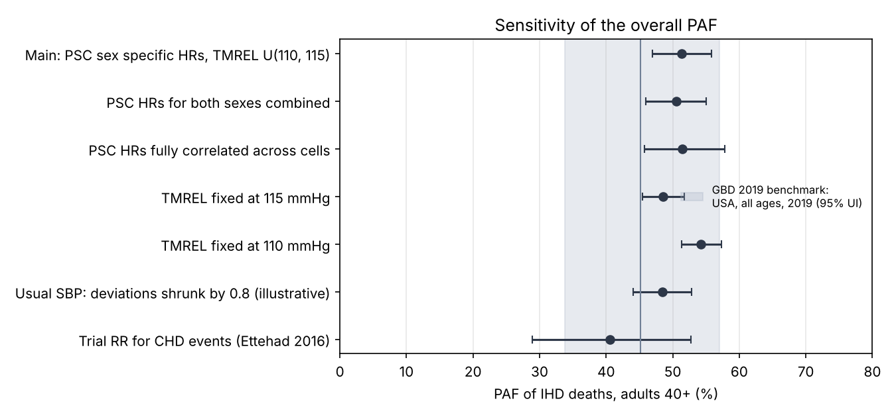

# 11 · Share of US heart disease deaths due to high systolic blood pressure: a population attributable fraction with 1,000 draws

## The problem

If nobody had systolic blood pressure (SBP) above the healthiest level, what share of ischemic heart disease (IHD) deaths would not happen? That share, the population attributable fraction (PAF), caps what blood pressure control can achieve. This project estimates it for US adults 40+ in 2018 by age and sex, combining measured exposure, a theoretical minimum risk exposure level (TMREL) and published relative risks over 1,000 draws.

## Why it matters

About half of US IHD deaths at 40+, roughly 187,000 in 2018, trace to SBP above 110 to 115 mmHg. The share is higher for women (60%) than men (46%): women's IHD deaths cluster at 80 or older, where their mean SBP is 147 mmHg.

## Data

* **Exposure:** CDC NHANES 2017-2018 [`DEMO_J`](https://wwwn.cdc.gov/Nchs/Data/Nhanes/Public/2017/DataFiles/DEMO_J.xpt) and [`BPX_J`](https://wwwn.cdc.gov/Nchs/Data/Nhanes/Public/2017/DataFiles/BPX_J.xpt), accessed 2026-11-11: 3,499 examined, non pregnant adults 40+ with an SBP reading (173 without one excluded, as `get_data.py` prints).
* **Deaths:** [WHO Mortality Database](https://www.who.int/data/data-collection-tools/who-mortality-database) ICD-10 part 5, United States 2018, causes I20 to I25, accessed 2026-11-11. Ages 40+ hold 363,097 of 365,744 IHD deaths (99.3%).
* **Relative risks:** Prospective Studies Collaboration (PSC) hazard ratios by age and sex, in `data/psc2002_ihd_hazard_ratios.csv`.

`data/README.md` documents every file.

## Method in plain words

1. **Exposure.** SBP is the mean of up to three valid readings. Each age by sex exposure distribution is the exam weighted set of real readings, with no assumed shape.
2. **Risk curve.** PSC found IHD death risk log linear in usual SBP down to at least 115 mmHg; its hazard ratio per 20 mmHg gives a slope, flat below the TMREL. Ages 80+ use the 80-89 ratio.
3. **Counterfactual.** As in GBD 2019, the TMREL is uniform on 110 to 115 mmHg.
4. **PAF and deaths.** Compare average risk now with risk at the TMREL; multiply by registered deaths.
5. **Uncertainty.** Each draw (seed 20261111) takes a Rao-Wu bootstrap replicate of the design (PSUs resampled within strata), a log normal draw of each published hazard ratio from its 95% CI (cells using the same estimate share the draw), and a TMREL draw. We report the mean and 2.5th to 97.5th percentiles.

For cell $c$ with people $i$, weights $w_i$ and slope $\beta_c = -\ln(\text{HR}_{20,c})/20$:

$$RR_c(x) = e^{\beta_c \max(x - \text{TMREL},\,0)}, \qquad \text{PAF}_c = \frac{\sum_i w_i RR_c(x_i) - \sum_i w_i}{\sum_i w_i RR_c(x_i)}, \qquad \text{PAF}_{40+} = \frac{\sum_c \text{PAF}_c D_c}{\sum_c D_c}$$

where $D_c$ is IHD deaths.

## How to run

```bash
cd projects/11-health-sbp-ihd-paf
python3 -m venv .venv && source .venv/bin/activate   # Python 3.11+
pip install -r requirements.txt
python run.py                     # 2 seconds; rewrites output/
pytest                            # 19 tests, including known answers
python get_data.py                # optional: rebuild data/ from CDC and WHO
Rscript validation/crosscheck.R   # optional: R 4.3.3, survey 4.2.1
```

## Results

**United States, 2018 (95% UI):**

| Group | IHD deaths | PAF % | Attributable deaths |
|---|---|---|---|
| Men 40+ | 213,056 | 45.6 (40.4 to 50.9) | 97,193 (86,084 to 108,399) |
| Women 40+ | 150,041 | 59.5 (54.1 to 65.2) | 89,324 (81,105 to 97,791) |
| **Both, 40+** | **363,097** | **51.4 (46.9 to 55.8)** | **186,517 (170,456 to 202,580)** |

All ten age by sex cells are in `output/headline_tables.md`.



**Checks.**
* GBD 2019 puts 45.2% (33.8 to 57.0) of US IHD deaths in 2019 on high SBP (all ages; appendix 2, Table S3). Our estimate falls inside; GBD's risk curves differ, so exact agreement is not expected. Danaei et al. (abstract) attributed 45% of all US cardiovascular deaths in 2005 to high blood pressure.
* R `survey` reproduces every cell's mean SBP, SE and central PAF (gap under 5e-5).
* `run.py` stops if SBP fails to rise with age, PAFs leave (0, 1), intervals miss estimates, or deaths fail to reconcile.

**Sensitivity, adults 40+:**

| Scenario | PAF % (95% UI) |
|---|---|
| Main | 51.4 (46.9 to 55.8) |
| PSC ratios, sexes combined | 50.5 (45.9 to 55.0) |
| PSC ratios fully correlated across cells | 51.5 (45.7 to 57.8) |
| TMREL 115 / 110 mmHg | 48.5 (45.5 to 51.8) / 54.2 (51.3 to 57.3) |
| SBP deviations × 0.8 (illustrative) | 48.5 (44.1 to 52.8) |
| Trial relative risk for CHD events (Ettehad 2016) | 40.6 (28.9 to 52.7) |



Trials capture a few years of lowering, not lifelong differences, so their risk is smaller. About 21% of attributable deaths arise in people with SBP below 140 mmHg (`headline.json`).

## Limitations

* PSC ratios refer to usual SBP; one visit spreads the distribution wider and overstates the PAF. The 0.8 shrink is an assumption.
* Hazard ratios are drawn independently across cells; full correlation widens the interval to 45.7 to 57.8.
* PSC cohorts excluded prior vascular disease and are decades old; NHANES SBP includes treated people.
* NHANES omits nursing home residents, yet 80+ holds 48% of deaths.
* WHO counts are not redistributed for ill defined causes as GBD does.
* 80+ shares one ratio; deaths under 40 or of unknown age are excluded; adults missing SBP are dropped without reweighting.
* Lags between exposure and death are ignored.

## What I would do next

* Estimate usual SBP spread from repeat measurements; add stroke, then DALYs.

## Sources

1. Lewington S, et al. (PSC). Age-specific relevance of usual blood pressure to vascular mortality. *Lancet* 2002;360:1903-13. https://doi.org/10.1016/S0140-6736(02)11911-8
2. Ettehad D, et al. Blood pressure lowering for prevention of cardiovascular disease and death. *Lancet* 2016;387:957-67. https://doi.org/10.1016/S0140-6736(15)01225-8
3. GBD 2019 Risk Factors Collaborators. *Lancet* 2020;396:1223-49. https://doi.org/10.1016/S0140-6736(20)30752-2
4. IHME Vivarium documentation, SBP exposure and TMREL. https://vivarium-research.readthedocs.io/en/stable/models/risk_exposures/sbp/index.html
5. Danaei G, et al. The preventable causes of death in the United States. *PLoS Med* 2009;6:e1000058. https://doi.org/10.1371/journal.pmed.1000058
6. Rao JNK, Wu CFJ. Resampling inference with complex survey data. *JASA* 1988;83:231-41. https://doi.org/10.1080/01621459.1988.10478591
