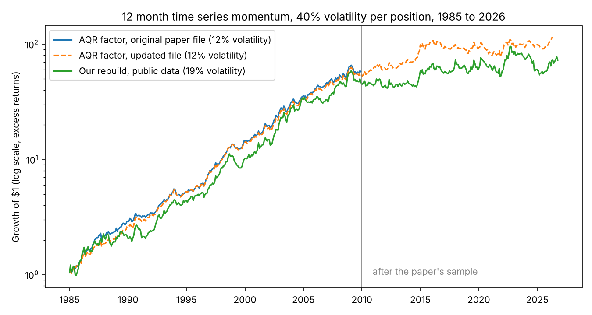

# 12. Time series momentum: replicating Moskowitz, Ooi and Pedersen (2012)

## The paper

Moskowitz, T. J., Ooi, Y. H., and Pedersen, L. H. (2012). Time series momentum. *Journal of Financial Economics* 104(2), 228 to 250. [doi:10.1016/j.jfineco.2011.11.003](https://doi.org/10.1016/j.jfineco.2011.11.003). Chicago Booth, AQR Capital Management, NYU.

**Status: peer reviewed.** Verification evidence: [output/authentication.md](output/authentication.md).

## The question

Does an asset's past 12 month excess return predict its next month? In 58 futures, 1985 to 2009, the paper's long risers, short fallers portfolio (40% volatility per position) earns a Sharpe ratio above one and 1.58% a month of alpha. Does that reproduce, survive the critiques, and last after 2009?

## Data

* **The authors' factor returns**: AQR's "Time Series Momentum: Original Paper Data" (1985 to 2009) and the updated factors (to May 2026), downloaded 11 Nov 2026; fetched by `get_data.py aqr`, not redistributed, vintage in `output/aqr_checksums_used.json`.
* **23 public substitutes for the futures**, daily from 1975 where published (`src/tsmom/instruments.py`):
  * 4 equity markets: US, and from 1990 Europe, Japan, Asia Pacific ex Japan; dollar excess returns, French library, to September 2026.
  * 7 government bonds as constant maturity par bonds: US 2, 5, 10 year (Fed H.15) financed at the 3 month bill; German 2, 5, 10 year (Bundesbank, from 1997) and Japanese 10 year (Ministry of Finance, from 1986) financed at the 1 year yield.
  * 9 currencies against the dollar, spot only: Fed H.10 (euro spliced with the mark before 1999).
  * 3 energy futures, EIA contracts 1 and 2 rolled five days before expiry by the exchange calendar: crude oil from 1985, natural gas from 1994, heating oil from 2007; all end April 2024.
* **Factors**: US market, SMB, HML, UMD (French library). `run.py` warns if raw files change.

## Method

As in sections 2.4 and 4.1: volatility is the annualized exponentially weighted variance of daily returns (center of mass 60 days) at month end t; the month t+1 position is the sign of the 12 month return times 40% / volatility (eq. 5), averaged over available instruments. Fig. 1 regresses r(t)/σ(t-1) on lag h of the scaled return or its sign (h = 1 to 60, clustered by month).

## How to run

```bash
python -m venv .venv && source .venv/bin/activate
pip install -r requirements.txt
python get_data.py aqr   # the AQR files (all other raw data are committed)
python run.py        # about 10 seconds; writes every table, chart and output/headline.json
pytest               # 31 tests, a few seconds
```

## Replication results

1985 to 2009 ([table 1](output/table1_replication.md)); the market factor is the US market because MSCI World history before 1997 is not public:

| | Paper | Authors' factor file | Our rebuild |
| --- | --- | --- | --- |
| Volatility | 12% | 12.3% | 18.2% |
| Sharpe ratio | above 1 | 1.38 | 0.94 |
| Alpha a month | 1.58% (t 7.99) | 1.22% (t 6.13) | 1.28% (t 4.24) |
| Beta on UMD | 0.28 (t 6.78) | 0.26 (t 6.45) | 0.29 (t 4.62) |
| Beta on market squared, quarterly | 1.99 (t 3.88) | 1.89 (t 3.57) | 2.97 (t 3.92) |
| Instruments positive, significant | 58, 52 of 58 | | 21, 10 of 22 |

**On the authors' own series, volatility, loadings and the straddle shape replicate; the printed alpha does not.** Plugging the paper's own printed loadings into this file's means gives an alpha of 1.20% a month, not 1.58%, so the table likely used a different vintage of the returns; a test pins the gap.

**Our rebuild correlates 0.74 with the authors' factor** (0.72 in equities, bonds and currencies, 0.40 in commodities). It is weaker because 23 instruments diversify less than 58, commodities are three energy contracts, equities are unhedged regions, currencies lack carry and bonds lack roll down.

Fig. 1 replicates in part ([chart](output/lag_tstats_paper_fig1.png)): 8 of lags 1 to 12 are positive (3 significant) and 33 of lags 13 to 60 negative, but lag 12 is negative; the paper has all 12 positive.



## Stress tests

Our rebuild, 1985 to 2009, every series 300 months ([table 2](output/table2_stress_out_of_sample.md), [grid](output/table3_grid_alpha_t.md)):

* **Instrument by instrument**, in the spirit of Huang, Li, Wang and Zhou (2020): the portfolio alpha t is 4.24, but only 10 of 22 instruments' own TSMOM returns are significant (paper: 52 of 58).
* **Volatility scaling** (Kim, Tse and Wald, 2016): Sharpe ratios for TSMOM and long only are 0.94 and 0.71 with the paper's scaling, 0.67 and 0.62 with expanding window volatility (risk parity without timing), 0.55 and 0.52 with equal notional. Without volatility timing, trend adds little over buy and hold, as they report. Scaled TSMOM still earns 1.19% a month (t 4.05) over scaled long only.
* **Multiple testing**: 64 look back and holding pairs were run (alphas on market, SMB, HML, UMD and our long only bond and commodity sleeves, Newey West). If all 64 had zero true Sharpe the expected best would be 0.80; the deflated Sharpe ratio of the 12 by 1 headline is 0.75, short of 0.95. The trials are highly correlated, so this is conservative. Its t of 5.40 clears the Harvey, Liu and Zhu hurdle of 3. All 25 cells up to 12 months have positive alpha t; the 12 by 1 cell is 4.61 (paper 6.61).
* **Costs and capacity**: turnover is 1.49 units of notional a month (bonds 2.88, as short bonds carry high leverage). Break even is 96 bp per unit traded; at a uniform 5 bp the Sharpe ratio moves from 0.94 to 0.89. Energy roll trades are not charged and capacity is not tested.
* **Uncertainty**: Sharpe 95% interval 0.67 to 1.36 (block bootstrap, 12 month blocks, fixed seed); 6 or 24 month blocks give similar intervals.

Pitfalls checklist:

* **Look ahead**: a test rewrites future returns and checks no earlier position moves; another checks roll dates against the EIA data.
* **Survivorship**: instruments are markets, not firms; coverage starts when public data do.
* **Leakage**: no model is fitted, so no purge or embargo is needed; overlapping signals get Newey West or clustered errors.

## Out of sample

The authors' updated factor earns 0.44% a month from 2010 to May 2026 (Sharpe 0.40, interval -0.09 to 0.74, Newey West t 1.74); alpha 0.30% (t 1.20). On the same file its UMD loading rises from 0.26 (1985 to 2009) to 0.51 (t 7.10). Our rebuild, correlated 0.81 with it, earns 0.36% a month (Sharpe 0.23, t 1.06), 0.30% after 2 bp costs, with a 44% drawdown. Bonds held up (Sharpe 0.48 ours, 0.45 AQR). AQR's currencies stayed positive (0.19); ours fell to -0.15, partly for lack of carry.

## Limitations

* The paper's futures are licensed; equities are unhedged regions, currency returns omit the interest differential and bond returns omit roll down.
* AQR rebuilds its updated history at each release; `run.py` warns if the files differ from the recorded vintage.

## Sources

* Huang, D., Li, J., Wang, L., and Zhou, G. (2020). Time series momentum: Is it there? *Journal of Financial Economics* 135(3), 774 to 794.
* Kim, A. Y., Tse, Y., and Wald, J. K. (2016). Time series momentum and volatility scaling. *Journal of Financial Markets* 30, 103 to 124.
* Bailey, D. H., and Lopez de Prado, M. (2014). The Deflated Sharpe Ratio. *Journal of Portfolio Management* 40(5), 94 to 107.
* Harvey, C. R., Liu, Y., and Zhu, H. (2016). ... and the Cross-Section of Expected Returns. *Review of Financial Studies* 29(1), 5 to 68.
* AQR data sets; French Data Library; Federal Reserve; Bundesbank; Ministry of Finance Japan; US EIA.
