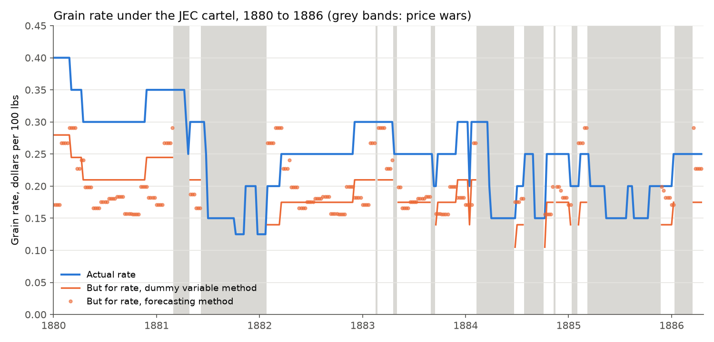
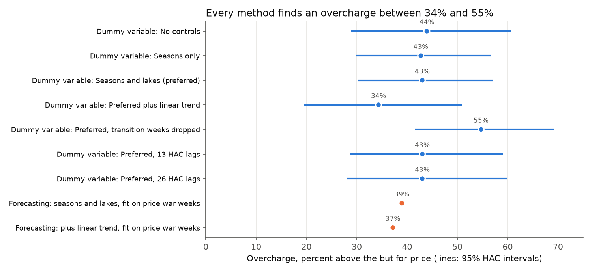

# 13. Cartel overcharge damages: the railroad grain cartel of 1880 to 1886

## The problem

When a cartel is caught, its customers sue for what they overpaid, and the court needs the price "but for" the cartel. This project runs that toolkit on the best known public cartel data, the Joint Executive Committee (JEC) railroad cartel (Porter 1983), and reports an overcharge, damages with a confidence interval, and the checks an expert would show.

## Why it matters

Specification choices move damages by millions, so a reviewer needs to see that the estimate is stable, predicts data it never saw, and is not an artifact of timing.

## Data

`data/CartelStability.csv`: 328 weeks, January 1880 to April 1886, from the AER R package (Rdatasets archive) (`get_data.py` re-downloads and hash checks it). Columns: grain rate (dollars per 100 lbs, Chicago to the Atlantic seaboard), tons shipped, a trade press collusion indicator (203 cartel and 125 price war weeks), whether the Great Lakes (the rival route) were frozen, and 13 seasons. It matches Porter's Table 2 on the rate and collusion share, which a test checks.

## Method in plain words

**Dummy variable method.** Compare rates in collusive and price war weeks after removing seasonal swings and lake competition. The gap is the overcharge.

**Forecasting method.** Learn how rates behaved in price war weeks, then predict each collusive week without the cartel.

Quantity is not a control: the cartel cut shipments, so fixing quantity would hide part of the overcharge.

**The math.** log P_t = a + b · Cartel_t + Σ g_s · Season_st + d · Lakes_t + e_t. The overcharge above the but for price is exp(b) − 1, or exp(b − var(b)/2) − 1 with the Kennedy (1981) correction. Errors are Newey and West (1987) HAC with 5 lags, since weekly errors are serially correlated; longer lags barely move it (table). Damages are D = Σ_cartel weeks (P_t − P_t^BF) · Q_t · 20, with P_t^BF = P_t · exp(−b) and 20 hundredweights per ton. The forecasting method fits the equation without the cartel term on war weeks (smearing retransformation). The volume effect uses a 2SLS demand elasticity (log tons on log rate, cartel dummy as instrument, HC1 errors).

**Checks.** Predict each held out price war. Rotate the cartel calendar by every shift of 26 weeks or more and count placebo effects as large as the real one. Vary controls, add a trend, drop the first two weeks of each spell after the first, use 13 and 26 HAC lags.

## How to run

```bash
cd projects/13-cartel-overcharge-damages
python -m venv .venv
source .venv/bin/activate
pip install -r requirements.txt
python run.py      # a few seconds
pytest             # 25 tests, a few seconds
```

## Results

Affected commerce in the 203 cartel weeks was $25.36 million (nominal 1880s dollars).

| Method | b | HAC s.e. | Overcharge % | Damages $m | 95% interval $m |
|:--|--:|--:|--:|--:|--:|
| Dummy: no controls | 0.364 | 0.057 | 43.9 | 7.74 | 5.68 to 9.59 |
| Dummy: seasons only | 0.356 | 0.048 | 42.7 | 7.59 | 5.85 to 9.18 |
| **Dummy: seasons and lakes (preferred)** | **0.358** | **0.048** | **43.0** | **7.63** | **5.88 to 9.22** |
| Dummy: plus linear trend | 0.295 | 0.059 | 34.3 | 6.48 | 4.15 to 8.56 |
| Dummy: transition weeks dropped (181 cartel weeks) | 0.436 | 0.046 | 54.7 | 7.73 | 6.42 to 8.94 |
| Dummy: 13 HAC lags | 0.358 | 0.054 | 43.0 | 7.63 | 5.65 to 9.41 |
| Dummy: 26 HAC lags | 0.358 | 0.057 | 43.0 | 7.63 | 5.54 to 9.50 |
| Forecasting: seasons and lakes | | | 39.0 | 6.60 | |
| Forecasting: plus linear trend | | | 37.2 | 6.37 | |

Overcharge % is exp(b) − 1 for dummy rows (Kennedy corrected: 42.9% for the preferred row) and actual over but for payments, minus one, for forecasting rows.

* **Preferred:** collusion raised the rate 43.0% above the price war level, so 30.1% of every dollar paid in cartel weeks was overcharge: **$7.63 million** (95% interval $5.88m to $9.22m).
* **Placebo timing:** none of 277 shifted calendars gives an effect as large (p = 0.004).
* **Out of sample:** on held out price wars the forecasting model's average absolute error per war (weighted by weeks) is 18.5%, and it predicts 9.0% too high on average (wars differ in depth). That understates harm, one reason the forecasting rows sit lower.
* **Volume effect (separate head of harm):** IV demand elasticity −0.867 (s.e. 0.134) implies 36.4% more tons without the cartel and a deadweight loss of about $1.39 million.
* **The trend matters most.** Rates drifted down while new railroads joined, and the first 61 weeks were all collusive, so a trend cuts the overcharge to 34%.





Outputs: [table](output/overcharge_table.md), [validation](output/validation_by_episode.csv), [headline numbers](output/headline.json), [summary](report/summary.md).

**Known answer tests** reproduce published regressions (MIT 14.271, Fall 2022, Problem Set 5 solutions): OLS demand elasticity −0.639 (s.e. 0.0733), first stage cartel coefficient 0.356 (s.e. 0.0261, R² 0.488), IV elasticity −0.867 (s.e. 0.134).

**Limits.** The cartel predates the Sherman Act (1890), so this demonstrates the method only. The benchmark is the price war rate: if wars were punishment phases below normal non collusive pricing, harm is overstated; if they were mild or brief, so war rates sat above that level, harm is understated. The trade press indicator is measured with error, which tends to bias b toward zero. Damages are nominal, without interest, trebling or pass on.

## What I would do next

* Add Porter's membership dummies and his supply equation.
* Add a yardstick: a comparable route outside the cartel.
* Bootstrap an interval for the forecasting method.

## Sources

1. Porter, R. H. (1983). A study of cartel stability: the Joint Executive Committee, 1880 to 1886. *Bell Journal of Economics* 14(2), 301 to 314.
2. European Commission (2013). *Practical Guide: Quantifying Harm in Actions for Damages Based on Breaches of Article 101 or 102 TFEU*. SWD(2013) 205.
3. ABA Section of Antitrust Law (2017). *Proving Antitrust Damages: Legal and Economic Issues*, 3rd edition.
4. Kennedy, P. E. (1981). Estimation with correctly interpreted dummy variables in semilogarithmic equations. *American Economic Review* 71(4), 801.
5. Newey, W. K. and West, K. D. (1987). A simple, positive semi definite, heteroskedasticity and autocorrelation consistent covariance matrix. *Econometrica* 55(3), 703 to 708.

Data: [Rdatasets, AER CartelStability](https://vincentarelbundock.github.io/Rdatasets/). Benchmarks: [MIT OpenCourseWare 14.271, Problem Set 5 solutions](https://ocw.mit.edu/courses/14-271-industrial-organization-i-fall-2022/mit14_271_f22_pset5_solutions.pdf).
